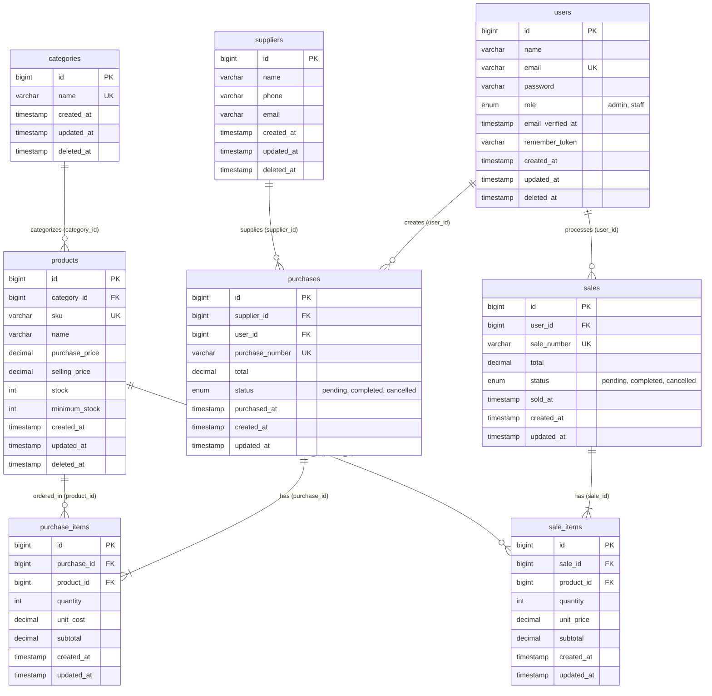

# Architecture Document

## Sora — Inventory & Sales Management System

**Version:** 1.0  
**Date:** 2026-10-27  
**Stack:** Laravel 11 · MySQL 8 · Blade · Vanilla CSS/JS

---

## 1. System Architecture Overview

```
┌─────────────────────────────────────────────────────┐
│                     Browser                          │
│              (HTML / CSS / JS)                       │
└──────────────────────┬──────────────────────────────┘
                       │ HTTP Request
                       ▼
┌─────────────────────────────────────────────────────┐
│              Laravel Application                     │
│                                                      │
│  ┌──────────┐   ┌────────────┐   ┌──────────────┐  │
│  │  Routes   │──▶│ Middleware │──▶│  Controller  │  │
│  │ (web.php) │   │ (auth,     │   │              │  │
│  │           │   │  role)     │   │              │  │
│  └──────────┘   └────────────┘   └──────┬───────┘  │
│                                          │          │
│                              ┌───────────▼────────┐ │
│                              │  Form Request /    │ │
│                              │  Validation        │ │
│                              └───────────┬────────┘ │
│                                          │          │
│                              ┌───────────▼────────┐ │
│                              │  Service Layer     │ │
│                              │  (Business Logic)  │ │
│                              └───────────┬────────┘ │
│                                          │          │
│                              ┌───────────▼────────┐ │
│                              │  Eloquent Model    │ │
│                              │  (ORM)             │ │
│                              └───────────┬────────┘ │
│                                          │          │
│                              ┌───────────▼────────┐ │
│                              │  Blade View        │ │
│                              │  (Response)        │ │
│                              └────────────────────┘ │
└──────────────────────┬──────────────────────────────┘
                       │
                       ▼
┌─────────────────────────────────────────────────────┐
│                MySQL (sora_db)                       │
└─────────────────────────────────────────────────────┘
```

---

## 2. Request Lifecycle

```
Browser → HTTP Request → Route (web.php)
    → Middleware (auth, role check)
    → Controller
    → Form Request / Validation
    → Service (business logic, DB::transaction)
    → Eloquent Model → MySQL
    → Blade Response → Browser
```

---

## 3. Directory Structure

```
sora/
├── app/
│   ├── Http/
│   │   ├── Controllers/
│   │   │   ├── Auth/
│   │   │   │   └── LoginController.php
│   │   │   ├── DashboardController.php
│   │   │   ├── CategoryController.php
│   │   │   ├── ProductController.php
│   │   │   ├── SupplierController.php
│   │   │   ├── UserController.php
│   │   │   ├── PurchaseController.php
│   │   │   └── SaleController.php
│   │   ├── Middleware/
│   │   │   └── RoleMiddleware.php
│   │   └── Requests/
│   │       ├── CategoryRequest.php
│   │       ├── ProductRequest.php
│   │       ├── SupplierRequest.php
│   │       ├── UserRequest.php
│   │       ├── PurchaseRequest.php
│   │       └── SaleRequest.php
│   ├── Models/
│   │   ├── User.php
│   │   ├── Category.php
│   │   ├── Product.php
│   │   ├── Supplier.php
│   │   ├── Purchase.php
│   │   ├── PurchaseItem.php
│   │   ├── Sale.php
│   │   └── SaleItem.php
│   └── Services/
│       ├── PurchaseService.php
│       └── SaleService.php
├── database/
│   ├── migrations/
│   │   ├── 0001_create_users_table.php
│   │   ├── 0002_create_categories_table.php
│   │   ├── 0003_create_products_table.php
│   │   ├── 0004_create_suppliers_table.php
│   │   ├── 0005_create_purchases_table.php
│   │   ├── 0006_create_purchase_items_table.php
│   │   ├── 0007_create_sales_table.php
│   │   └── 0008_create_sale_items_table.php
│   └── seeders/
│       └── UserSeeder.php
├── resources/
│   ├── views/
│   │   ├── layouts/
│   │   │   └── app.blade.php
│   │   ├── auth/
│   │   │   └── login.blade.php
│   │   ├── dashboard/
│   │   │   ├── admin.blade.php
│   │   │   └── staff.blade.php
│   │   ├── categories/
│   │   │   ├── index.blade.php
│   │   │   ├── create.blade.php
│   │   │   └── edit.blade.php
│   │   ├── products/
│   │   │   ├── index.blade.php
│   │   │   ├── create.blade.php
│   │   │   ├── edit.blade.php
│   │   │   └── show.blade.php
│   │   ├── suppliers/
│   │   │   ├── index.blade.php
│   │   │   ├── create.blade.php
│   │   │   └── edit.blade.php
│   │   ├── users/
│   │   │   ├── index.blade.php
│   │   │   ├── create.blade.php
│   │   │   └── edit.blade.php
│   │   ├── purchases/
│   │   │   ├── index.blade.php
│   │   │   ├── create.blade.php
│   │   │   └── show.blade.php
│   │   └── sales/
│   │       ├── index.blade.php
│   │       ├── create.blade.php
│   │       └── show.blade.php
│   ├── css/
│   │   └── app.css
│   └── js/
│       └── app.js
├── routes/
│   └── web.php
├── public/
│   ├── css/
│   │   └── app.css
│   └── js/
│       └── app.js
└── .env.example
```

---

## 4. Routing Architecture

### 4.1 Public Routes

```
GET  /login           → LoginController@showLoginForm
POST /login           → LoginController@login
POST /logout          → LoginController@logout
```

### 4.2 Authenticated Routes (middleware: auth)

```
GET  /dashboard       → DashboardController@index

# Products (all authenticated users can view)
GET  /products              → ProductController@index
GET  /products/{id}         → ProductController@show
```

### 4.3 Admin-Only Routes (middleware: auth, role:admin)

```
# Products CRUD
GET  /products/create       → ProductController@create
POST /products              → ProductController@store
GET  /products/{id}/edit    → ProductController@edit
PUT  /products/{id}         → ProductController@update
DELETE /products/{id}       → ProductController@destroy

# Categories CRUD
resource: /categories       → CategoryController (index, create, store, edit, update, destroy)

# Suppliers CRUD
resource: /suppliers        → SupplierController (index, create, store, edit, update, destroy)

# Users CRUD
resource: /users            → UserController (index, create, store, edit, update, destroy)

# Transaction cancellation
PATCH /purchases/{id}/cancel → PurchaseController@cancel
PATCH /sales/{id}/cancel     → SaleController@cancel
```

### 4.4 Authenticated Transaction Routes (middleware: auth)

```
# Purchases
GET  /purchases              → PurchaseController@index
GET  /purchases/create       → PurchaseController@create
POST /purchases              → PurchaseController@store
GET  /purchases/{id}         → PurchaseController@show
PATCH /purchases/{id}/complete → PurchaseController@complete

# Sales
GET  /sales                  → SaleController@index
GET  /sales/create           → SaleController@create
POST /sales                  → SaleController@store
GET  /sales/{id}             → SaleController@show
PATCH /sales/{id}/complete   → SaleController@complete
```

---

## 5. Model Relationships

```php
// User
hasMany(Purchase::class)
hasMany(Sale::class)

// Category
hasMany(Product::class)
// uses SoftDeletes

// Product
belongsTo(Category::class)
hasMany(PurchaseItem::class)
hasMany(SaleItem::class)
// uses SoftDeletes

// Supplier
hasMany(Purchase::class)
// uses SoftDeletes

// Purchase
belongsTo(Supplier::class)
belongsTo(User::class)
hasMany(PurchaseItem::class)

// PurchaseItem
belongsTo(Purchase::class)
belongsTo(Product::class)

// Sale
belongsTo(User::class)
hasMany(SaleItem::class)

// SaleItem
belongsTo(Sale::class)
belongsTo(Product::class)
```

---

## 6. Service Layer

### 6.1 PurchaseService

```
createPurchase(data):
  1. Generate purchase_number (PUR-YYYYMMDD-XXXX)
  2. DB::transaction:
     a. Create Purchase header (status: pending)
     b. Create PurchaseItems
     c. Calculate subtotals server-side
     d. Calculate and set total
  3. Return Purchase

completePurchase(purchase):
  1. Validate status == pending
  2. DB::transaction:
     a. For each item: product.stock += item.quantity
     b. Set status = completed
  3. Return Purchase

cancelPurchase(purchase):
  1. Validate status == pending
  2. Set status = cancelled
  3. Return Purchase
```

### 6.2 SaleService

```
createSale(data):
  1. Generate sale_number (SAL-YYYYMMDD-XXXX)
  2. DB::transaction:
     a. Create Sale header (status: pending)
     b. For each item: validate product.stock >= quantity
     c. Create SaleItems with unit_price from product.selling_price
     d. Calculate subtotals server-side
     e. Calculate and set total
  3. Return Sale

completeSale(sale):
  1. Validate status == pending
  2. DB::transaction:
     a. For each item:
        - Lock product row (pessimistic lock)
        - Validate product.stock >= item.quantity
        - product.stock -= item.quantity
     b. Set status = completed
  3. Return Sale
  4. On failure: rollback, return error

cancelSale(sale):
  1. Validate status == pending
  2. Set status = cancelled
  3. Return Sale
```

---

## 7. Middleware Architecture

```
web (default Laravel middleware group)
├── auth (Laravel built-in)
│   ├── All authenticated routes
│   └── role:admin
│       ├── Category CRUD
│       ├── Supplier CRUD
│       ├── User CRUD
│       ├── Product create/edit/delete
│       └── Transaction cancel
```

### RoleMiddleware Logic

```php
public function handle($request, Closure $next, string $role)
{
    if (auth()->user()->role !== $role) {
        abort(403);
    }
    return $next($request);
}
```

---

## 8. Validation Strategy

| Layer | Purpose |
|-------|---------|
| HTML attributes | UX hint (required, min, type) — does NOT replace server validation |
| Form Request | Server-side validation with rules (required, unique, exists, numeric, min) |
| Database constraints | Last defense (UNIQUE, FK, NOT NULL, ENUM) |

### Key Validation Rules

| Entity | Field | Rules |
|--------|-------|-------|
| Product | sku | required, unique:products,sku,{id} |
| Product | category_id | required, exists:categories,id |
| Product | purchase_price, selling_price | required, numeric, min:0 |
| Product | stock, minimum_stock | required, integer, min:0 |
| Purchase | supplier_id | required, exists:suppliers,id |
| Purchase | items.*.product_id | required, exists:products,id |
| Purchase | items.*.quantity | required, integer, min:1 |
| Purchase | items.*.unit_cost | required, numeric, min:0 |
| Sale | items.*.product_id | required, exists:products,id |
| Sale | items.*.quantity | required, integer, min:1 |
| Category | name | required, unique:categories,name,{id} |
| User | email | required, email, unique:users,email,{id} |

---

## 9. Error Handling Architecture

| Error Type | Handling |
|------------|----------|
| **Validation Error** | Return to form with errors, preserve input |
| **Business Rule Error** | Flash error message, redirect back (e.g., insufficient stock) |
| **Database Failure** | DB::transaction rollback, flash generic error |
| **Authorization** | 403 abort via middleware |
| **Not Found** | 404 via route model binding |
| **Production** | APP_DEBUG=false, no stack traces |

---

## 10. Security Measures

| Concern | Implementation |
|---------|---------------|
| Authentication | Laravel built-in auth, bcrypt hashing |
| Authorization | RoleMiddleware + server-side checks |
| CSRF | `@csrf` directive on all forms |
| XSS | Blade `{{ }}` auto-escaping |
| SQL Injection | Eloquent ORM parameterized queries |
| Mass Assignment | `$fillable` on all models |
| Secrets | `.env` file, `.env.example` committed (no secrets) |

---

## 11. Database Design

### 11.1 ERD (Mermaid)



### 11.2 Key Indexes

- `users.email` — UNIQUE
- `products.sku` — UNIQUE
- `categories.name` — UNIQUE
- `purchases.purchase_number` — UNIQUE
- `sales.sale_number` — UNIQUE
- All foreign keys auto-indexed by MySQL

### 11.3 Soft Delete Tables

- `users`, `categories`, `products`, `suppliers` → include `deleted_at` column

---

## 12. Deployment Checklist

1. Clone repository
2. `composer install`
3. `cp .env.example .env`
4. Configure DB credentials in `.env`
5. `php artisan key:generate`
6. `php artisan migrate`
7. `php artisan db:seed`
8. `php artisan serve`

### Demo Accounts

| Role | Email | Password |
|------|-------|----------|
| Admin | admin@sora.test | password |
| Staff | staff@sora.test | password |
